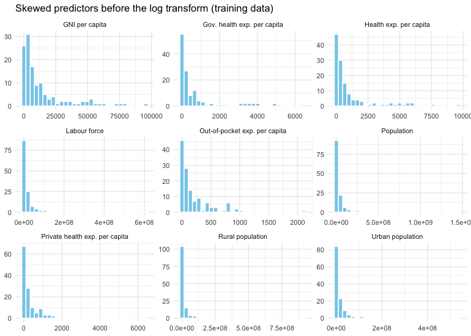
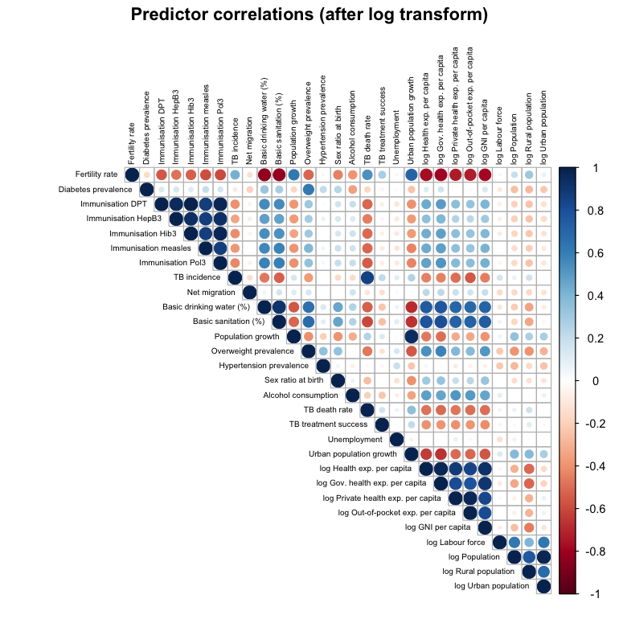
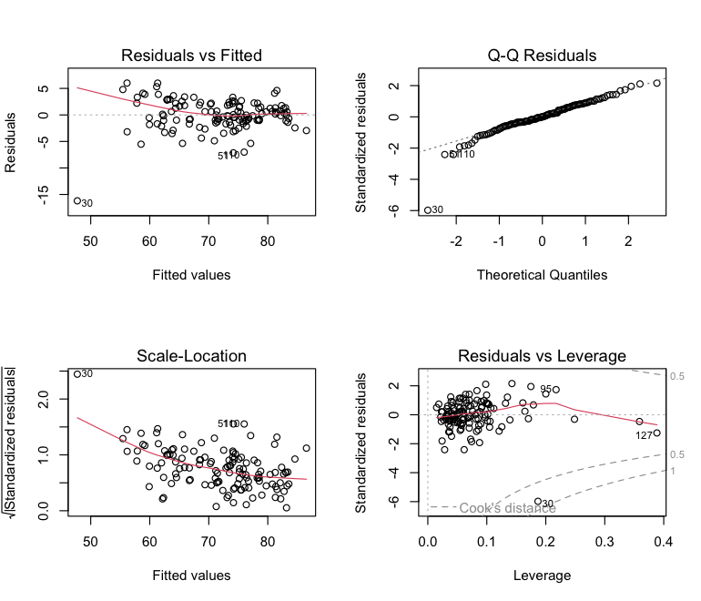
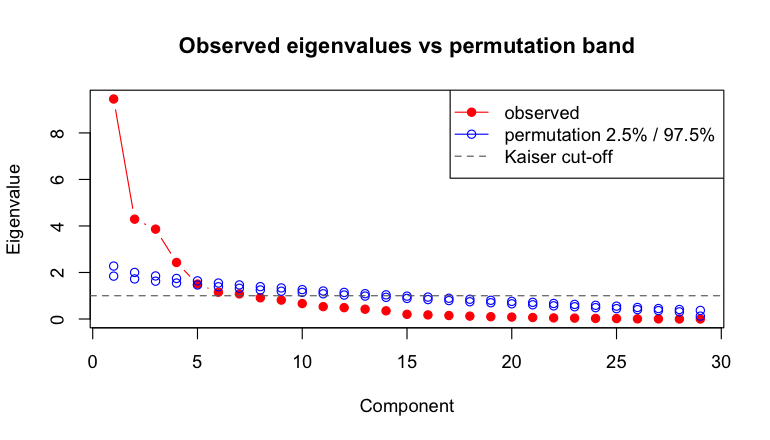
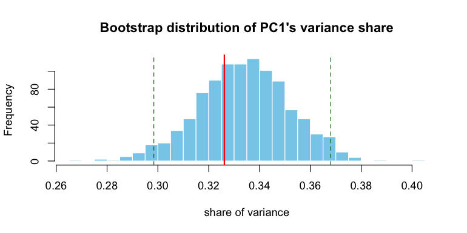
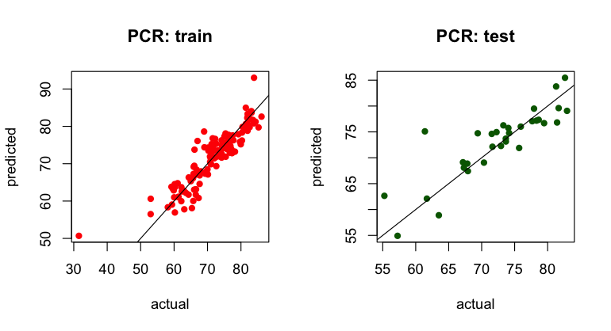
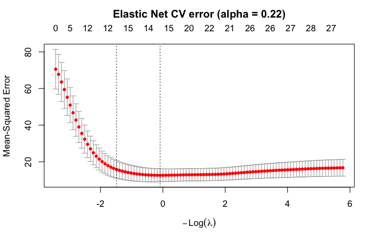

What drives life expectancy? OLS, PCA/PCR and Elastic Net on World Bank
indicators
================

- [1. Data preparation](#1-data-preparation)
- [2. OLS with stepwise selection](#2-ols-with-stepwise-selection)
- [3. Principal component analysis](#3-principal-component-analysis)
- [4. Principal component regression](#4-principal-component-regression)
- [5. Elastic Net](#5-elastic-net)
- [6. Test-set comparison](#6-test-set-comparison)
- [7. Predictions for countries without life
  expectancy](#7-predictions-for-countries-without-life-expectancy)
- [Conclusions](#conclusions)

**Question:** which economic, demographic and health indicators explain
differences in life expectancy at birth across countries? How well can
they *predict* it for countries where it is missing?

**Data:**

- **Source:** World Bank *Health, Nutrition and Population Statistics*.
  There are 160 countries with 29 indicators each: fertility, health
  expenditure, immunisation, sanitation, disease burden, population and
  so on.
- **Target:** life expectancy at birth.
- **Prediction task:** three further countries (the Netherlands, Kenya
  and Colombia) have the indicators but no life expectancy. They are
  predicted at the end.

**Approach:** four models with increasing flexibility, all fitted on the
same 80/20 train/test split:

1.  **OLS with stepwise AIC selection:** the interpretable baseline. A
    version with an interaction term is also tested.
2.  **PCA:** describes the correlation structure of the predictors.
    Components are chosen with the Kaiser rule, a 70% variance threshold
    and a permutation test; PC1’s stability is checked with a bootstrap.
3.  **Principal component regression (PCR)** on the retained components.
4.  **Elastic Net:** penalised regression, with $\alpha$ and $\lambda$
    tuned by repeated cross-validation.

``` r
library(tidyverse)
library(MASS, exclude = "select")  # stepAIC
library(car)       # VIF
library(broom)
library(boot)
library(pls)       # PCR
library(caret)     # preProcess, repeated CV
library(glmnet)
library(corrplot)
library(knitr)
```

## 1. Data preparation

The train/test split is made **before** any imputation or scaling.
Missing values are filled with *training* means, so no information from
the test countries leaks into the models.

``` r
main_df  <- read.csv("data/health_nutrition_population.csv")
life_exp <- read.csv("data/life_expectancy.csv")[, 2:3]   # drop the index column
new_df   <- read.csv("data/new_countries.csv")

target <- "Life.expectancy.at.birth..total..years."
data <- merge(main_df, life_exp, by = "Country") |> filter(!is.na(.data[[target]]))

Y <- data[[target]]
X <- data[, !(names(data) %in% c("Country", target))]
cat(nrow(X), "countries,", ncol(X), "predictors; share missing per predictor: max",
    round(100 * max(colMeans(is.na(X)))), "%\n")
```

    ## 160 countries, 29 predictors; share missing per predictor: max 7 %

``` r
set.seed(123)
idx_tr <- sample.int(nrow(X), floor(0.8 * nrow(X)))
idx_te <- setdiff(seq_len(nrow(X)), idx_tr)

train_means <- colMeans(X[idx_tr, ], na.rm = TRUE)
impute <- function(df) { for (v in names(df)) df[[v]][is.na(df[[v]])] <- train_means[[v]]; df }
X_train <- impute(X[idx_tr, ]); X_test <- impute(X[idx_te, ])
y_train <- Y[idx_tr];           y_test <- Y[idx_te]
cat("train:", length(y_train), " test:", length(y_test), "\n")
```

    ## train: 128  test: 32

Short labels for tables and plots:

``` r
label_map <- c(
  "Fertility.rate" = "Fertility rate", "Current.health.expenditure" = "Health exp. per capita",
  "Diabetes" = "Diabetes prevalence", "Domestic.general.government" = "Gov. health exp. per capita",
  "Domestic.private" = "Private health exp. per capita", "GNI.per.capita" = "GNI per capita",
  "DPT" = "Immunisation DPT", "HepB3" = "Immunisation HepB3", "Hib3" = "Immunisation Hib3",
  "measles" = "Immunisation measles", "Pol3" = "Immunisation Pol3",
  "Incidence.of.tuberculosis" = "TB incidence", "Labor.force" = "Labour force",
  "Net.migration" = "Net migration", "Out.of.pocket" = "Out-of-pocket exp. per capita",
  "drinking.water" = "Basic drinking water (%)", "sanitation" = "Basic sanitation (%)",
  "Urban.population.growth" = "Urban population growth", "Population.growth" = "Population growth",
  "Population..total" = "Population", "overweight" = "Overweight prevalence",
  "hypertension" = "Hypertension prevalence", "Rural.population" = "Rural population",
  "Sex.ratio" = "Sex ratio at birth", "alcohol" = "Alcohol consumption",
  "Tuberculosis.death" = "TB death rate", "Tuberculosis.treatment" = "TB treatment success",
  "Unemployment" = "Unemployment", "Urban.population" = "Urban population"
)
pretty_one <- function(x) {
  out <- x
  for (i in seq_along(x)) {
    hit <- which(sapply(names(label_map), grepl, x = x[i], fixed = TRUE))[1]
    if (!is.na(hit)) out[i] <- paste0(if (startsWith(x[i], "log_")) "log " else "", label_map[[hit]])
  }
  out
}
pretty <- function(x) sapply(strsplit(x, ":", fixed = TRUE), function(p) paste(pretty_one(p), collapse = " × "))
```

**Skewed variables.** Expenditure, income and population variables are
heavily right-skewed. They are log-transformed for the OLS model, using
`log1p` because one variable can be zero.

``` r
log_vars <- c(
  "Current.health.expenditure.per.capita..current.US..",
  "Domestic.general.government.health.expenditure.per.capita..current.US..",
  "Domestic.private.health.expenditure.per.capita..current.US..",
  "Out.of.pocket.expenditure.per.capita..current.US..",
  "GNI.per.capita..Atlas.method..current.US..",
  "Labor.force..total", "Population..total", "Rural.population", "Urban.population"
)
X_train[, log_vars] |>
  pivot_longer(everything()) |>
  mutate(name = pretty(name)) |>
  ggplot(aes(value)) + geom_histogram(bins = 30, fill = "skyblue", colour = "white") +
  facet_wrap(~ name, scales = "free", ncol = 3) + theme_minimal(base_size = 9) +
  labs(title = "Skewed predictors before the log transform (training data)", x = NULL, y = NULL)
```



``` r
add_logs <- function(df) {
  for (v in log_vars) { df[[paste0("log_", v)]] <- log1p(df[[v]]); df[[v]] <- NULL }
  df
}
train_data <- data.frame(add_logs(X_train), Life_Expectancy = y_train)
test_data  <- data.frame(add_logs(X_test),  Life_Expectancy = y_test)
```

``` r
cm <- cor(train_data[, names(train_data) != "Life_Expectancy"])
dimnames(cm) <- list(pretty(rownames(cm)), pretty(colnames(cm)))
corrplot(cm, method = "circle", type = "upper", tl.cex = 0.55, tl.col = "black",
         title = "Predictor correlations (after log transform)", mar = c(0, 0, 1.5, 0))
```



There are strong blocks of correlated predictors: the expenditure and
income variables, the immunisation rates, and the population size
variables. This motivates PCA/PCR and the Elastic Net later on.

## 2. OLS with stepwise selection

``` r
null_model <- lm(Life_Expectancy ~ 1, data = train_data)
full_model <- lm(Life_Expectancy ~ ., data = train_data)
ols <- stepAIC(null_model, scope = list(lower = null_model, upper = full_model),
               direction = "both", trace = FALSE)

tidy(ols, conf.int = TRUE) |>
  mutate(term = pretty(term)) |>
  kable(digits = 3, caption = "Stepwise OLS coefficients (training data)")
```

| term | estimate | std.error | statistic | p.value | conf.low | conf.high |
|:---|---:|---:|---:|---:|---:|---:|
| (Intercept) | 65.882 | 4.739 | 13.902 | 0.000 | 56.497 | 75.266 |
| log Gov. health exp. per capita | 1.344 | 0.278 | 4.839 | 0.000 | 0.794 | 1.894 |
| TB death rate | -0.096 | 0.017 | -5.540 | 0.000 | -0.131 | -0.062 |
| Fertility rate | -1.956 | 0.404 | -4.837 | 0.000 | -2.757 | -1.155 |
| Hypertension prevalence | -0.161 | 0.046 | -3.502 | 0.001 | -0.252 | -0.070 |
| Basic sanitation (%) | 0.045 | 0.020 | 2.201 | 0.030 | 0.004 | 0.085 |
| Urban population growth | 0.450 | 0.257 | 1.752 | 0.082 | -0.058 | 0.958 |
| Immunisation HepB3 | 0.056 | 0.023 | 2.388 | 0.019 | 0.010 | 0.102 |
| log Urban population | 0.478 | 0.180 | 2.650 | 0.009 | 0.121 | 0.835 |
| log Rural population | -0.289 | 0.135 | -2.144 | 0.034 | -0.557 | -0.022 |

Stepwise OLS coefficients (training data)

``` r
glance(ols) |> dplyr::select(r.squared, adj.r.squared, sigma, AIC, BIC, nobs) |> kable(digits = 3)
```

| r.squared | adj.r.squared | sigma |     AIC |    BIC | nobs |
|----------:|--------------:|------:|--------:|-------:|-----:|
|      0.88 |         0.871 | 3.005 | 656.488 | 687.86 |  128 |

``` r
vif_ols <- vif(ols)
tibble(predictor = pretty(names(vif_ols)), VIF = round(vif_ols, 2)) |> kable()
```

| predictor                       |  VIF |
|:--------------------------------|-----:|
| log Gov. health exp. per capita | 4.60 |
| TB death rate                   | 1.69 |
| Fertility rate                  | 4.35 |
| Hypertension prevalence         | 1.22 |
| Basic sanitation (%)            | 4.62 |
| Urban population growth         | 2.63 |
| Immunisation HepB3              | 1.46 |
| log Urban population            | 2.29 |
| log Rural population            | 2.72 |

``` r
par(mfrow = c(2, 2)); plot(ols); par(mfrow = c(1, 1))
```



**Reading the OLS model**

- Stepwise AIC keeps nine predictors. They explain 87% of the variation
  in life expectancy (adjusted R²).
- Life expectancy is higher with:
  - **government health spending** (log);
  - **sanitation access**;
  - **HepB3 immunisation**;
  - a larger urban population.
- It is lower with:
  - **fertility**;
  - **tuberculosis mortality**;
  - **hypertension**.
- Urban population growth is kept by AIC but is not significant at 5%.
- All VIFs are below 5. The residual plots show no strong
  heteroscedasticity or influential points.

**Interaction test:** does public health spending pay off more where
sanitation is better?

``` r
ols_int <- update(ols, . ~ . +
  log_Domestic.general.government.health.expenditure.per.capita..current.US.. :
  People.using.at.least.basic.sanitation.services....of.population.)
tidy(ols_int) |> filter(grepl(":", term)) |> mutate(term = pretty(term)) |> kable(digits = 3)
```

| term | estimate | std.error | statistic | p.value |
|:---|---:|---:|---:|---:|
| log Gov. health exp. per capita × Basic sanitation (%) | -0.002 | 0.008 | -0.259 | 0.796 |

``` r
tibble(model = c("OLS", "OLS + interaction"),
       adj_R2 = c(summary(ols)$adj.r.squared, summary(ols_int)$adj.r.squared),
       AIC = c(AIC(ols), AIC(ols_int)), BIC = c(BIC(ols), BIC(ols_int))) |> kable(digits = 3)
```

| model             | adj_R2 |     AIC |     BIC |
|:------------------|-------:|--------:|--------:|
| OLS               |  0.871 | 656.488 | 687.860 |
| OLS + interaction |  0.870 | 658.414 | 692.639 |

The interaction is small and not significant, and AIC and BIC both get
worse. The association between spending and life expectancy does not
depend on sanitation levels.

## 3. Principal component analysis

PCA uses all 29 predictors, standardised with *training* means and
standard deviations.

``` r
scaler <- preProcess(X_train, method = c("center", "scale"))
X_tr <- predict(scaler, X_train); X_te <- predict(scaler, X_test)

pca <- prcomp(X_tr)
eig <- pca$sdev^2
pca_tab <- tibble(PC = seq_along(eig), eigenvalue = eig,
                  prop_var = eig / sum(eig), cum_var = cumsum(eig) / sum(eig))
kable(head(pca_tab, 10), digits = 3, caption = "First ten components")
```

|  PC | eigenvalue | prop_var | cum_var |
|----:|-----------:|---------:|--------:|
|   1 |      9.458 |    0.326 |   0.326 |
|   2 |      4.292 |    0.148 |   0.474 |
|   3 |      3.863 |    0.133 |   0.607 |
|   4 |      2.429 |    0.084 |   0.691 |
|   5 |      1.503 |    0.052 |   0.743 |
|   6 |      1.154 |    0.040 |   0.783 |
|   7 |      1.079 |    0.037 |   0.820 |
|   8 |      0.911 |    0.031 |   0.851 |
|   9 |      0.813 |    0.028 |   0.879 |
|  10 |      0.664 |    0.023 |   0.902 |

First ten components

``` r
k_kaiser <- sum(eig > 1)
k_70     <- which(pca_tab$cum_var >= 0.70)[1]
cat("Kaiser rule:", k_kaiser, "components | 70% variance:", k_70, "components\n")
```

    ## Kaiser rule: 7 components | 70% variance: 5 components

**Permutation test.** Each column is shuffled independently, which
destroys the correlations between predictors. This shows how large the
eigenvalues get from noise alone. A component is worth keeping if its
observed eigenvalue lies above the permutation band.

``` r
set.seed(8)
perm_eig <- replicate(200, prcomp(apply(X_tr, 2, sample))$sdev^2)
band <- apply(perm_eig, 1, quantile, c(0.025, 0.975))

plot(eig, type = "b", pch = 19, col = "red", xlab = "Component", ylab = "Eigenvalue",
     main = "Observed eigenvalues vs permutation band")
lines(band[2, ], type = "b", col = "blue", pch = 1); lines(band[1, ], type = "b", col = "blue", pch = 1)
abline(h = 1, lty = 2, col = "grey40")
legend("topright", c("observed", "permutation 2.5% / 97.5%", "Kaiser cut-off"),
       col = c("red", "blue", "grey40"), lty = c(1, 1, 2), pch = c(19, 1, NA))
```



``` r
cat("Components above the permutation band:", sum(cumprod(eig > band[2, ])), "\n")
```

    ## Components above the permutation band: 4

**Bootstrap of PC1.** The countries are resampled 1,000 times to see how
stable PC1’s share of the variance is.

``` r
set.seed(123)
pc1_share <- function(d, i) { e <- prcomp(d[i, ], scale. = TRUE)$sdev^2; e[1] / sum(e) }
fit_boot <- boot(X_tr, pc1_share, R = 1000)
ci_pc1 <- quantile(fit_boot$t, c(0.025, 0.975))
hist(fit_boot$t, breaks = 30, col = "skyblue", border = "white",
     main = "Bootstrap distribution of PC1's variance share", xlab = "share of variance")
abline(v = ci_pc1, lty = 2, col = "darkgreen"); abline(v = fit_boot$t0, col = "red", lwd = 2)
```



``` r
cat(sprintf("PC1 explains %.3f of the variance, 95%% bootstrap CI [%.3f, %.3f]\n",
            fit_boot$t0, ci_pc1[1], ci_pc1[2]))
```

    ## PC1 explains 0.326 of the variance, 95% bootstrap CI [0.298, 0.368]

``` r
k_keep <- min(k_kaiser, k_70)
top_loadings <- function(k, n = 5) {
  l <- pca$rotation[, k]; o <- order(abs(l), decreasing = TRUE)[1:n]
  paste0(pretty(names(l)[o]), " (", sprintf("%+.2f", l[o]), ")", collapse = ", ")
}
tibble(PC = paste0("PC", 1:k_keep), `largest loadings` = sapply(1:k_keep, top_loadings)) |> kable()
```

| PC | largest loadings |
|:---|:---|
| PC1 | Basic sanitation (%) (+0.28), Fertility rate (-0.28), Basic drinking water (%) (+0.27), Immunisation Pol3 (+0.26), Immunisation DPT (+0.25) |
| PC2 | Population (+0.42), Labour force (+0.41), Rural population (+0.41), Urban population (+0.40), Net migration (-0.24) |
| PC3 | Health exp. per capita (+0.31), Out-of-pocket exp. per capita (+0.30), Private health exp. per capita (+0.30), Hypertension prevalence (-0.30), Gov. health exp. per capita (+0.28) |
| PC4 | Immunisation Hib3 (-0.33), Immunisation HepB3 (-0.32), Immunisation DPT (-0.31), Overweight prevalence (+0.30), Urban population growth (-0.29) |
| PC5 | Population growth (+0.43), Alcohol consumption (-0.42), Diabetes prevalence (+0.39), TB incidence (-0.38), TB death rate (-0.33) |

The three rules disagree:

- the Kaiser rule keeps 7 components;
- the 70% variance threshold keeps 5;
- the permutation test finds only the first 4 clearly above noise.

The 70% threshold is used, which keeps **5 components**. The first five
components have clear meanings:

1.  public-health infrastructure and immunisation versus fertility;
2.  population size;
3.  health spending;
4.  immunisation versus overweight and urban growth;
5.  disease and lifestyle.

## 4. Principal component regression

``` r
rmse <- function(pred, actual) sqrt(mean((pred - actual)^2))
set.seed(123)
pcr_fit <- pcr(y_train ~ ., data = data.frame(X_tr, y_train), ncomp = 10, validation = "CV")

cv_rmse <- RMSEP(pcr_fit, estimate = "CV")$val[1, 1, -1]
tibble(components = 1:10,
       `X variance explained (%)` = cumsum(explvar(pcr_fit))[1:10],
       `CV RMSE` = cv_rmse,
       `test RMSE` = sapply(1:10, function(k) rmse(predict(pcr_fit, X_te, ncomp = k), y_test))) |>
  kable(digits = 3, caption = "PCR by number of components")
```

| components | X variance explained (%) | CV RMSE | test RMSE |
|-----------:|-------------------------:|--------:|----------:|
|          1 |                   32.615 |   3.971 |     4.315 |
|          2 |                   47.415 |   3.944 |     4.354 |
|          3 |                   60.737 |   3.936 |     4.063 |
|          4 |                   69.114 |   3.948 |     4.048 |
|          5 |                   74.297 |   3.911 |     3.615 |
|          6 |                   78.275 |   3.896 |     3.573 |
|          7 |                   81.996 |   3.882 |     3.586 |
|          8 |                   85.139 |   3.927 |     3.591 |
|          9 |                   87.942 |   4.076 |     3.611 |
|         10 |                   90.233 |   3.838 |     3.715 |

PCR by number of components

``` r
pred_pcr_tr <- as.numeric(predict(pcr_fit, X_tr, ncomp = k_keep))
pred_pcr    <- as.numeric(predict(pcr_fit, X_te, ncomp = k_keep))
cat(sprintf("PCR with %d components: train RMSE %.3f | test RMSE %.3f\n",
            k_keep, rmse(pred_pcr_tr, y_train), rmse(pred_pcr, y_test)))
```

    ## PCR with 5 components: train RMSE 3.578 | test RMSE 3.615

The number of components is chosen *before* looking at the test set,
using the 70% rule. The table shows the test RMSE for every $k$ only as
a sensitivity check. Picking $k$ from that column would be overfitting
to the test set.

``` r
par(mfrow = c(1, 2))
plot(y_train, pred_pcr_tr, pch = 16, col = "red", main = "PCR: train", xlab = "actual", ylab = "predicted"); abline(0, 1)
plot(y_test, pred_pcr, pch = 16, col = "darkgreen", main = "PCR: test", xlab = "actual", ylab = "predicted"); abline(0, 1)
```



``` r
par(mfrow = c(1, 1))
```

## 5. Elastic Net

Tuning has two stages:

1.  A coarse grid over $\alpha$ (the mix between ridge and lasso) and
    $\lambda$ (the strength of the penalty), scored with 10-fold
    cross-validation repeated 5 times.
2.  A fine $\lambda$ path at the chosen $\alpha$ with `cv.glmnet`.

``` r
set.seed(8)
enet_caret <- train(
  x = X_tr, y = y_train, method = "glmnet",
  tuneGrid = expand.grid(alpha = seq(0, 1, length = 10), lambda = 10^seq(-3, 0.5, length = 15)),
  trControl = trainControl(method = "repeatedcv", number = 10, repeats = 5)
)
best_alpha <- enet_caret$bestTune$alpha
cat("best alpha:", round(best_alpha, 3), "| coarse lambda:", round(enet_caret$bestTune$lambda, 3), "\n")
```

    ## best alpha: 0.222 | coarse lambda: 1

``` r
set.seed(8)
cv_en <- cv.glmnet(as.matrix(X_tr), y_train, alpha = best_alpha, nfolds = 10, standardize = FALSE)
plot(cv_en); title(sprintf("Elastic Net CV error (alpha = %.2f)", best_alpha), line = 2.5)
```



``` r
pred_en <- as.numeric(predict(cv_en, as.matrix(X_te), s = "lambda.min"))
cat(sprintf("lambda.min = %.3f | train RMSE %.3f | test RMSE %.3f\n", cv_en$lambda.min,
            rmse(predict(cv_en, as.matrix(X_tr), s = "lambda.min"), y_train), rmse(pred_en, y_test)))
```

    ## lambda.min = 1.093 | train RMSE 3.048 | test RMSE 3.333

``` r
coefs <- as.matrix(coef(cv_en, s = "lambda.min"))[, 1]
tibble(predictor = pretty(names(coefs)), coefficient = coefs) |>
  filter(coefficient != 0, predictor != "(Intercept)") |>
  arrange(desc(abs(coefficient))) |>
  kable(digits = 3, caption = "Non-zero Elastic Net coefficients (standardised predictors, lambda.min)")
```

| predictor                   | coefficient |
|:----------------------------|------------:|
| Fertility rate              |      -2.289 |
| Basic sanitation (%)        |       1.339 |
| TB death rate               |      -1.310 |
| Basic drinking water (%)    |       0.966 |
| Gov. health exp. per capita |       0.939 |
| Hypertension prevalence     |      -0.569 |
| GNI per capita              |       0.506 |
| TB incidence                |      -0.447 |
| Health exp. per capita      |       0.391 |
| TB treatment success        |      -0.368 |
| Immunisation Hib3           |       0.300 |
| Immunisation DPT            |       0.257 |
| Immunisation HepB3          |       0.227 |
| Immunisation Pol3           |       0.063 |
| Overweight prevalence       |       0.028 |
| Sex ratio at birth          |       0.018 |

Non-zero Elastic Net coefficients (standardised predictors, lambda.min)

The predictors are standardised, so the coefficients are directly
comparable: years of life expectancy per one-standard-deviation change.

## 6. Test-set comparison

``` r
pred_ols     <- predict(ols, test_data)
pred_ols_int <- predict(ols_int, test_data)
r2 <- function(pred, actual) 1 - sum((actual - pred)^2) / sum((actual - mean(actual))^2)

comparison <- tibble(
  model = c("OLS (stepwise)", "OLS + interaction", sprintf("PCR (k = %d)", k_keep), "Elastic Net"),
  `test RMSE (years)` = c(rmse(pred_ols, y_test), rmse(pred_ols_int, y_test), rmse(pred_pcr, y_test), rmse(pred_en, y_test)),
  `test R²` = c(r2(pred_ols, y_test), r2(pred_ols_int, y_test), r2(pred_pcr, y_test), r2(pred_en, y_test)),
  predictors = c(length(coef(ols)) - 1, length(coef(ols_int)) - 1, k_keep, sum(coefs[-1] != 0))
) |> arrange(`test RMSE (years)`)
kable(comparison, digits = 3)
```

| model             | test RMSE (years) | test R² | predictors |
|:------------------|------------------:|--------:|-----------:|
| Elastic Net       |             3.333 |   0.781 |         16 |
| PCR (k = 5)       |             3.615 |   0.743 |          5 |
| OLS (stepwise)    |             3.771 |   0.720 |          9 |
| OLS + interaction |             3.833 |   0.711 |         10 |

``` r
# how much of the gap between models is noise? bootstrap the 32 test countries
set.seed(1)
errs <- cbind(OLS = pred_ols, PCR = pred_pcr, ENet = pred_en) - y_test
b <- replicate(2000, { i <- sample(length(y_test), replace = TRUE); sqrt(colMeans(errs[i, ]^2)) })
ci <- function(d) sprintf("%.2f [%.2f, %.2f]", mean(d), quantile(d, .025), quantile(d, .975))
tibble(comparison = c("RMSE OLS − Elastic Net", "RMSE PCR − Elastic Net"),
       `mean difference [95% bootstrap CI]` = c(ci(b["OLS", ] - b["ENet", ]), ci(b["PCR", ] - b["ENet", ]))) |> kable()
```

| comparison             | mean difference \[95% bootstrap CI\] |
|:-----------------------|:-------------------------------------|
| RMSE OLS − Elastic Net | 0.41 \[-0.14, 0.94\]                 |
| RMSE PCR − Elastic Net | 0.23 \[-0.45, 1.06\]                 |

## 7. Predictions for countries without life expectancy

``` r
X_new <- impute(new_df[, names(X_train)])
X_new_scaled <- predict(scaler, X_new)
new_logged <- add_logs(X_new)

predictions <- tibble(
  country = new_df$Country,
  OLS = predict(ols, new_logged),
  PCR = as.numeric(predict(pcr_fit, X_new_scaled, ncomp = k_keep)),
  `Elastic Net` = as.numeric(predict(cv_en, as.matrix(X_new_scaled), s = "lambda.min"))
)
kable(predictions, digits = 1, caption = "Predicted life expectancy at birth (years)")
```

| country     |  OLS |  PCR | Elastic Net |
|:------------|-----:|-----:|------------:|
| Netherlands | 82.7 | 82.5 |        82.1 |
| Kenya       | 66.6 | 63.8 |        64.9 |
| Colombia    | 78.8 | 74.4 |        76.5 |

Predicted life expectancy at birth (years)

## Conclusions

- **Drivers:**
  - **Disease burden** (tuberculosis mortality, hypertension) and
    **fertility** are the strongest negative factors.
  - **Public health spending, sanitation and immunisation** are the
    strongest positive factors.
  - Spending works about equally well at every sanitation level: the
    interaction is not significant.
- **Structure:**
  - The 29 indicators carry much less independent information than their
    number suggests.
  - PC1, a development / public-health axis, already explains about a
    third of their variance, and that share is stable under the
    bootstrap.
- **Prediction:**
  - All models reach a test RMSE of 3.3–3.8 years on unseen countries.
  - The Elastic Net is the most accurate.
  - With only 32 test countries, the bootstrap shows that its advantage
    over OLS and PCR is *not* clearly significant.
  - On the three new countries the models agree for the Netherlands
    (within 0.6 years). They differ by 3–4 years for Kenya and Colombia,
    which is about the size of the test error. A single model’s point
    prediction should be read with that uncertainty in mind.
- **Limitations:**
  - This is one cross-section, so the associations are not causal.
  - Mean imputation shrinks variation in the imputed variables.
  - PCA, PCR and the Elastic Net use the predictors on their original
    scale, while OLS uses the log-transformed ones. The skewed variables
    could therefore weigh differently in the two families of models.
